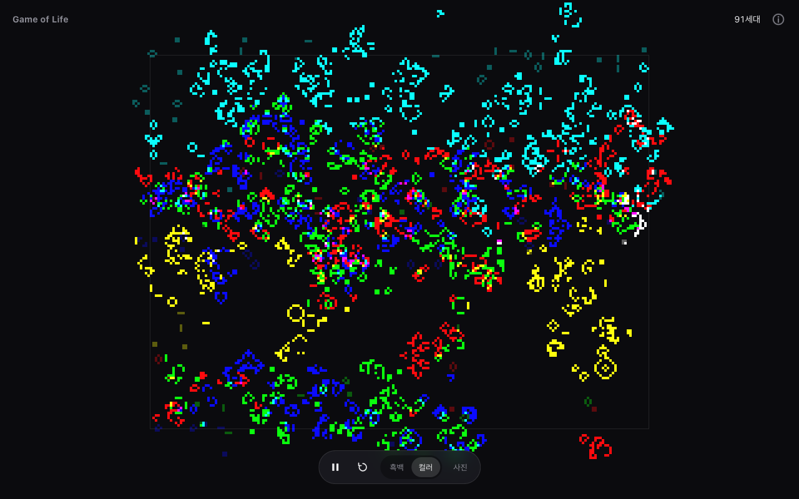
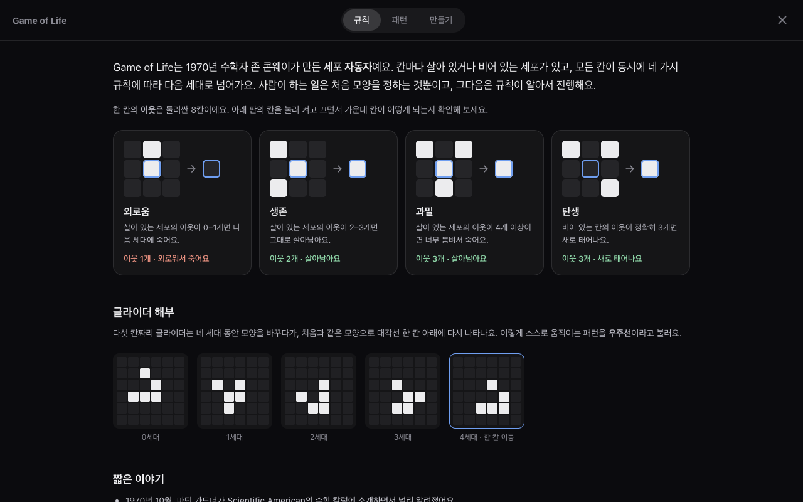
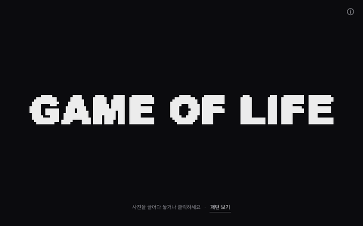
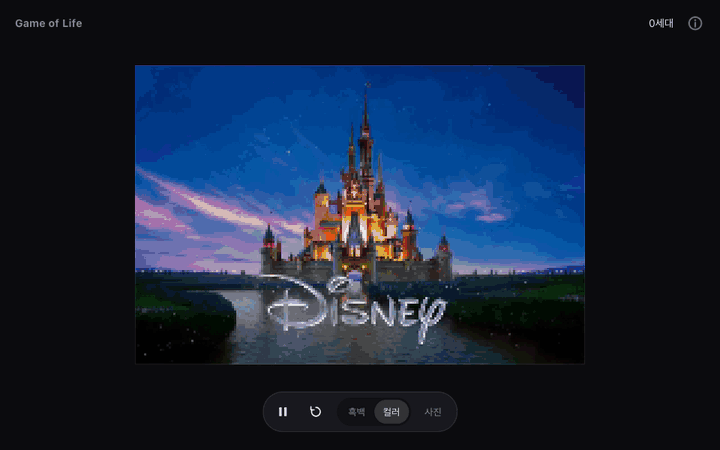
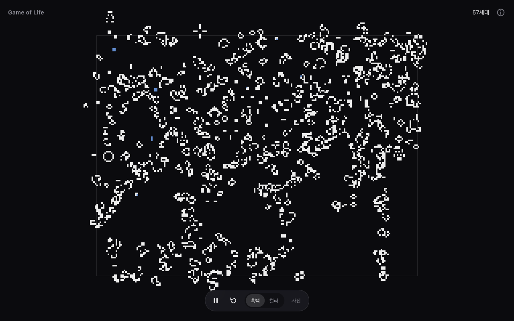
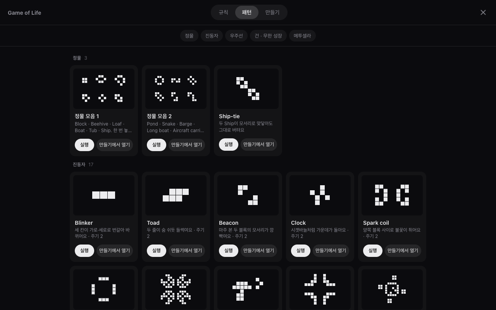
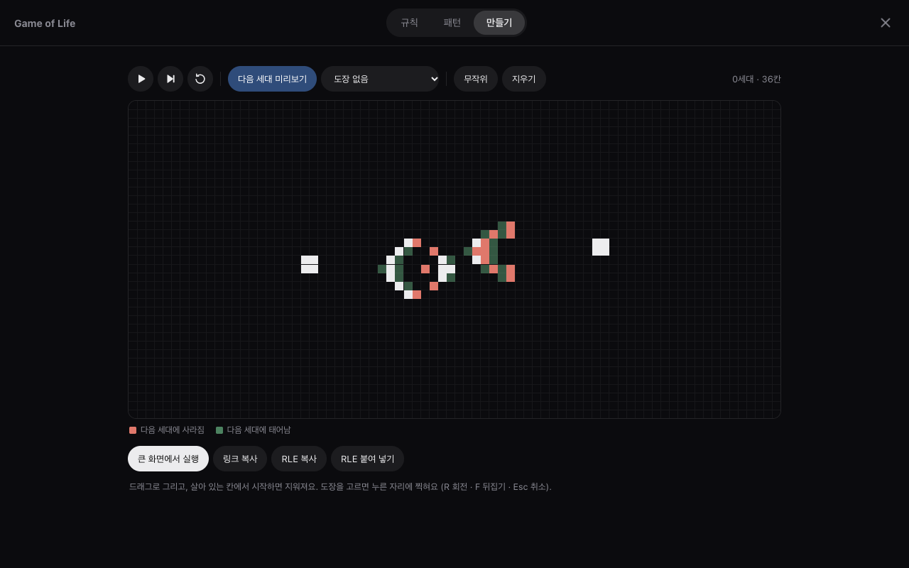

# Game of Life — 사진으로 시작하는 생명 게임

> 사용자가 올린 사진을 Conway의 Game of Life 초기 상태로 변환하여, 세포가 규칙에 따라 생성·소멸하며 진화하는 과정을 시각화하는 웹사이트입니다.



---

## 목차

1. [개요](#개요)
2. [Game of Life의 규칙](#game-of-life의-규칙)
3. [주요 기능](#주요-기능)
4. [실행 방법](#실행-방법)
5. [조작 방법 및 단축키](#조작-방법-및-단축키)
6. [자주 묻는 질문](#자주-묻는-질문)
7. [용어 정리](#용어-정리)
8. [참고 자료](#참고-자료)

---

## 개요

**Game of Life(생명 게임)** 는 1970년 영국의 수학자 **존 콘웨이(John Conway)** 가 고안한 **세포 자동자(cellular automaton)** 입니다. 일반적인 게임과 달리 플레이어가 개입하지 않으며, 초기 상태가 주어지면 이후의 변화는 정해진 규칙에 의해서만 결정됩니다.

- 평면은 격자로 나뉘며, 각 칸을 **세포(cell)** 라고 합니다.
- 각 세포는 **살아 있음** 또는 **비어 있음**의 두 가지 상태 중 하나를 가집니다.
- 한 번의 갱신 단위를 **세대(generation)** 라고 하며, 매 세대마다 모든 세포가 동시에 규칙을 적용받아 다음 상태로 전이합니다.

본 프로젝트는 여기에 **사진을 초기 상태로 사용한다**는 아이디어를 더했습니다. 사진의 밝기(또는 색상) 정보를 세포의 생사로 변환한 뒤, 그 사진이 생명 게임의 규칙에 따라 변화해 가는 과정을 보여 줍니다.

---

## Game of Life의 규칙

한 세포를 둘러싼 **8개의 칸**을 **이웃**이라 하며, 살아 있는 이웃의 수에 따라 다음 세대의 상태가 결정됩니다.

| 규칙 | 조건 | 결과 |
|---|---|---|
| **고립** | 살아 있는 세포의 이웃이 0~1개 | 다음 세대에 죽습니다 |
| **생존** | 살아 있는 세포의 이웃이 2~3개 | 다음 세대에도 살아남습니다 |
| **과밀** | 살아 있는 세포의 이웃이 4개 이상 | 다음 세대에 죽습니다 |
| **탄생** | 비어 있는 칸의 이웃이 정확히 3개 | 다음 세대에 새로운 세포가 태어납니다 |

이처럼 단순한 규칙만으로도 스스로 이동하는 패턴, 주기적으로 반복되는 패턴, 무한히 성장하는 패턴 등 복잡한 현상이 나타납니다. 나아가 Game of Life는 임의의 계산을 모사할 수 있는 **튜링 완전(Turing complete)** 한 체계임이 증명되어 있습니다.

> 사이트 우측 상단의 **ⓘ 버튼 → "규칙" 탭**에서 각 규칙을 직접 조작하며 확인할 수 있습니다.



---

## 주요 기능

### 1. 첫 화면
사이트에 접속하면 "Game of Life" 문구가 세포로 변환되어 흩어지고, 상태가 안정되면 다시 문구의 형태로 재조합됩니다.



### 2. 사진 기반 시뮬레이션
1. 사진을 화면에 **끌어다 놓거나**, 화면을 **클릭**하여 파일을 선택합니다. 모바일 환경에서는 화면을 탭하면 됩니다.
2. 원본 사진이 잠시 표시된 후, **좌상단에서 우하단 방향으로 물결이 퍼지듯** 세포로 변환되며 시뮬레이션이 시작됩니다.
3. 시뮬레이션 속도는 점차 빨라지며, 전체 상태가 **안정화**되면 화면 중앙에 **"안정화까지 걸린 세대"** 가 표시됩니다.



**색상 모드**
- **흑백 모드**: 사진을 명도 기준으로 이진화하여, 밝은 영역은 살아 있는 세포로, 어두운 영역은 빈칸으로 변환합니다.
- **컬러 모드**: 빨강(R)·초록(G)·파랑(B) 세 채널을 각각 독립된 생명 게임으로 실행한 뒤 겹쳐서 표시합니다. 예를 들어 R과 G가 동시에 살아 있으면 노란색, 세 채널이 모두 살아 있으면 흰색으로 나타납니다.
- 두 모드 모두 변화를 멈추고 안정화된 세포는 **어둡게** 표시되어, 여전히 변화 중인 영역과 구분됩니다.

| 흑백 모드 | 컬러 모드 |
|---|---|
|  |  |

> 업로드한 사진은 **외부 서버로 전송되지 않으며**, 모든 처리는 사용자의 브라우저 내에서만 이루어집니다.

### 3. 패턴 라이브러리 (ⓘ → "패턴" 탭)
Game of Life 연구에서 알려진 대표적인 패턴들을 다섯 가지 범주로 정리했습니다. 각 항목을 선택하면 전체 화면에서 실행됩니다.

| 범주 | 설명 | 예시 |
|---|---|---|
| **정물 (Still life)** | 변화하지 않고 고정된 상태를 유지합니다 | Block, Beehive, Boat |
| **진동자 (Oscillator)** | 일정한 주기로 같은 형태를 반복합니다 | Blinker, Pulsar, Pentadecathlon |
| **우주선 (Spaceship)** | 형태를 유지한 채 평면 위를 이동합니다 | Glider, LWSS, Copperhead |
| **건 · 무한 성장 (Gun)** | 다른 패턴을 끝없이 생성하거나 계속 성장합니다 | Gosper glider gun |
| **메투셀라 (Methuselah)** | 작은 초기 형태에서 출발해 오랜 기간 변화한 뒤 안정화됩니다 | R-pentomino, Acorn, Diehard |



### 4. 패턴 편집기 (ⓘ → "만들기" 탭)
- **그리기**: 드래그하여 세포를 그립니다. 살아 있는 칸에서 드래그를 시작하면 지우기로 동작합니다.
- **도장**: 라이브러리의 패턴을 선택해 원하는 위치에 배치할 수 있으며, 회전과 뒤집기를 지원합니다.
- **다음 세대 미리보기**: 다음 세대에 소멸할 세포와 새로 탄생할 세포를 색으로 구분하여 표시합니다.
- **편집 도구**: 한 세대씩 진행, 되돌리기, 무작위 채우기, 전체 지우기 기능을 제공합니다.
- **실행 및 공유**: "큰 화면에서 실행"으로 작성한 패턴을 전체 화면에서 실행할 수 있습니다. "링크 복사"를 사용하면 패턴 정보가 포함된 URL이 생성되어 다른 사람과 공유할 수 있습니다.
- **RLE 입출력**: 패턴을 LifeWiki 표준 형식인 RLE로 복사하거나, 외부 RLE를 붙여 넣어 불러올 수 있습니다.



---

## 실행 방법

본 프로젝트는 별도의 설치나 빌드 과정 없이 웹 브라우저만으로 실행됩니다.

### 방법 1: 파일 직접 열기

1. GitHub 저장소 페이지 상단의 **`<> Code`** 버튼을 클릭합니다.
2. **`Download ZIP`** 을 선택하여 파일을 내려받습니다.
3. 내려받은 ZIP 파일의 압축을 해제합니다.
4. 폴더 내의 **`index.html`** 파일을 웹 브라우저(Chrome, Safari, Edge 등)로 엽니다.

> 브라우저의 보안 정책에 따라 클립보드 복사 등 일부 기능이 파일을 직접 열었을 때 제한될 수 있습니다. 이 경우 방법 2를 이용하시기 바랍니다.

### 방법 2: 로컬 서버로 실행

터미널(macOS) 또는 명령 프롬프트(Windows)에서 프로젝트 폴더로 이동한 뒤 다음 명령을 실행합니다.

```bash
python3 -m http.server 8000
```

이후 브라우저 주소창에 **`http://localhost:8000`** 을 입력하면 사이트에 접속할 수 있습니다. 서버를 종료하려면 터미널에서 `Ctrl + C` 를 누릅니다.

> Windows 환경에서 `python3` 명령이 인식되지 않으면 `python -m http.server 8000` 을 사용합니다.

---

## 조작 방법 및 단축키

### 화면 버튼
| 버튼 | 기능 |
|---|---|
| ⏸ / ▶ | 일시정지 / 재생 |
| 🔄 | 처음부터 다시 실행 |
| 흑백 / 컬러 | 색상 모드 전환 (사진 모드에서만 적용) |
| 사진 | 다른 사진 선택 |
| 좌측 상단 "Game of Life" | 첫 화면으로 이동 |
| 우측 상단 ⓘ | 규칙 · 패턴 · 만들기 페이지 열기 |

### 키보드 단축키
| 키 | 기능 |
|---|---|
| `Space` | 재생 / 일시정지 |
| `R` | 처음부터 다시 실행 (편집기에서는 도장 회전) |
| `C` | 컬러 / 흑백 전환 |
| `I` | 규칙 페이지 열기 |
| `P` | 패턴 페이지 열기 |
| `Esc` | 페이지 닫기 |
| `→` | (편집기) 한 세대 진행 |
| `F` | (편집기) 도장 뒤집기 |
| `Ctrl/⌘ + Z` | (편집기) 되돌리기 |
| `Ctrl/⌘ + V` | 클립보드의 이미지 붙여 넣기 |

---

## 자주 묻는 질문

**Q. 업로드한 사진이 서버에 저장됩니까?**
A. 저장되지 않습니다. 사진은 사용자의 브라우저 내에서만 처리되며 외부로 전송되지 않습니다.

**Q. 어떤 사진이 흥미로운 결과를 만듭니까?**
A. 명암 대비가 뚜렷한 사진(인물 실루엣, 하늘과 건물의 경계 등)이 다양한 패턴을 만들어 냅니다. 컬러 모드에서는 색상이 다양한 사진일수록 시각적으로 풍부한 결과를 얻을 수 있습니다.

**Q. 사진이 열리지 않습니다.**
A. JPG 또는 PNG 형식으로 다시 시도해 주시기 바랍니다. 일부 특수한 이미지 형식은 브라우저에서 지원되지 않을 수 있습니다.

**Q. "안정화"란 무엇입니까?**
A. 세포 집단이 더 이상 새로운 상태로 변하지 않고, 고정되어 있거나 짧은 주기의 반복만 남은 상태를 의미합니다. 사이트는 이 상태에 도달하기까지 걸린 세대 수를 표시합니다.

**Q. 모바일 기기에서도 사용할 수 있습니까?**
A. 가능합니다. 화면을 탭하여 사진을 선택하면 됩니다.

---

## 용어 정리

| 용어 | 의미 |
|---|---|
| **세포 (Cell)** | 격자를 구성하는 한 칸으로, 살아 있거나 비어 있는 상태를 가집니다 |
| **이웃 (Neighborhood)** | 한 세포를 둘러싼 8개의 칸 (무어 이웃, Moore neighborhood) |
| **세대 (Generation)** | 규칙이 한 번 적용되는 시간 단위 |
| **세포 자동자 (Cellular automaton)** | 격자 위의 칸들이 국소적인 규칙에 따라 상태를 갱신하는 계산 모델 |
| **안정화** | 더 이상 새로운 변화가 일어나지 않는 상태 |
| **RLE (Run Length Encoding)** | 패턴을 문자열로 압축하여 표기하는 형식. 예: `bo$2bo$3o!` 는 글라이더를 나타냅니다 |
| **튜링 완전 (Turing complete)** | 이론적으로 임의의 계산을 수행할 수 있는 성질 |

---

## 참고 자료

- Martin Gardner, "Mathematical Games: The fantastic combinations of John Conway's new solitaire game 'life'", *Scientific American*, 1970년 10월.
- [LifeWiki](https://conwaylife.com/wiki/): 본 프로젝트의 패턴 데이터는 LifeWiki의 RLE 표준 형식을 따릅니다.
